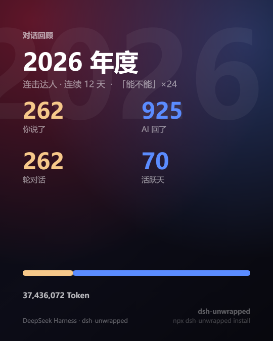

# dsh-unwrapped

[](#license)
[](package.json)
[](https://github.com/ErnestW2019/dsh-unwrapped/actions/workflows/test.yml)
[](package.json)
[](https://github.com/ErnestW2019/dsh-unwrapped)

**Wrapped, but for your AI conversations.** Monthly, quarterly and yearly reports of
human-vs-AI dialogue: how much each side said, when you showed up, which sessions mattered,
and the sentences you actually typed.

```bash
npx dsh-unwrapped install
```

Restart `dsh web`, then open `http://127.0.0.1:8080/unwrapped`.


No upload · no database · no model calls · no build step. The data source is the session log
the harness already writes; nothing enters the model context and nothing costs tokens.

> **Not a rewind tool.** Plugins like `rewind` / `recall` roll conversations and files back
> a step. This one is read-only: it turns logs into a shareable report and never touches your
> sessions or workspace files.

## What you get

Beyond the report page, three share cards you can post directly:

| Main | Contrast | Catchphrase |
| :--: | :--: | :--: |
|  |  |  |
| Four headline numbers + your title + closing line | Big share number + you-vs-AI character counts — the social one | The word you kept repeating |

The report itself is a **single HTML file**: animated charts, count-ups, theme switch, period
switching and card export all live inside it. No framework, no bundler, no external requests.
An exported file keeps switching periods when you open it from disk.

To see the rendered result: the screenshot above is the top of the yearly report. The full
interactive versions (animated charts, period switching, theme toggle, share cards) are
`preview-year.html` / `preview-quarter.html` / `preview-empty.html` under `docs/` — download and
open them; they work completely offline.

## What it answers

- **Who is talking** — messages you sent vs replies from the model, and the split. By message
  count, not by tokens.
- **When you show up** — 24-hour heat strip, weekday distribution, busiest day.
- **Who you work with** — models, providers, tools, workspaces, agent presets.
- **Which sessions mattered** — top 6 by activity: title, rounds, tokens, duration, and your
  own words.
- **What you left behind** — first and latest line, the latest one out (with the clock time and
  quote), the longest sitting, your most repeated word, and a timeline of the first line of
  every stretch.

The sentence layer is pure extraction and counting — never generated — so the same input
always produces the same report.

## Install

Requires Node ≥ 22.15 (uses `zlib.zstdDecompressSync`) and a harness profile that has been
started at least once.

```bash
npx dsh-unwrapped install                 # into $DSH_HOME/profiles/web
```

Then **restart** `dsh web` and open `http://127.0.0.1:8080/unwrapped`.

Other flags:

```bash
npx dsh-unwrapped install --profile tui   # another profile
npx dsh-unwrapped install --language en --label "Wrapped"
npx dsh-unwrapped install --dry-run       # print what would change, write nothing
npx dsh-unwrapped status                  # is it installed? is the patch line there?
npx dsh-unwrapped uninstall               # remove the patch line + the plugin dir
```

The installer does two things: copies the plugin into
`$DSH_HOME/profiles/<profile>/plugins/dsh-unwrapped`, and maintains exactly **one** `insert`
line in `cordis.patch.yml`. Re-running is idempotent and never touches anyone else's patch
lines.

> **Two things that trip people up.**
> `~/.dsh/profiles/<profile>` must already exist — run `dsh --profile web` once, or the
> installer stops with `profile not found`.
> And if the UI does not change: `config` (language, label, route) hot-reloads, but **edited
> plugin code needs a restart of `dsh web`** — Node caches ES modules by URL, so re-applying
> the patch only remounts config, it does not re-read files.

Prefer not to use `npx`? Clone the repo instead:

```bash
git clone https://github.com/ErnestW2019/dsh-unwrapped.git
cd dsh-unwrapped && node bin/plugin.js install
```

For the harness-free CLI, see "Offline CLI" below.

## Privacy

- Reports are generated **locally**. Nothing is collected, exported or uploaded; there are no
  remote requests.
- No database, no new files: logs are read, aggregated in memory per period, cached for 60s.
- Routes are registered on the existing local GUI server, which binds to loopback by default.
- The JSON API exposes session titles, workspace paths and up to 3 human prompts (170 chars
  each). To avoid that, move `path` / `apiPath` to something unguessable or turn off `launcher`
  and use the offline CLI only.

Locking it down:

```yaml
- insert:
    - id: rewind
      name: ./plugins/dsh-unwrapped/index.js
      config:
        launcher: false
        path: /x-<random>
        apiPath: /x-<random>-api
```

## Configuration

Every key under `config` in `cordis.patch.yml` is optional:

| key | default | meaning |
| --- | --- | --- |
| `path` | `/unwrapped` | report route (exact match) |
| `apiPath` | `/api/unwrapped` | JSON API route |
| `language` | `zh` | `zh` / `en` copy pack |
| `launcher` | `true` | inject a floating link into the GUI shell |
| `launcherLabel` | `年度回顾` | label for that link |
| `maxSessions` | `800` | read the newest N sessions |
| `concurrency` | `4` | sessions read in parallel |
| `cacheTtlMs` | `60000` | how long aggregated facts stay cached |
| `logErrors` | `true` | log a failed session read without failing the report |

## HTTP API

```
GET /unwrapped?period=month|quarter|year&key=2026-06|2026-Q2|2026&tz=480
GET /api/unwrapped?period=year
```

- Omit `key` for the current period; a malformed key falls back to it.
- `tz` is a minute offset, **east positive** (`480` = UTC+8); it defaults to the host zone.
  Period boundaries are cut at local midnight.
- `/api/unwrapped` returns `{ period, generatedAt, report }`.
- `?partial=1` (or the `x-unwrapped-partial: 1` header) returns just the report body, so the
  page can swap periods in place.

## Offline CLI

No harness needed — point it at a log directory (this is how the previews in `docs/` are built):

```bash
# reads $DSH_HOME/sessions (or ~/.dsh/sessions) by default
node bin/unwrapped.js --period year --out unwrapped.html --json report.json

# bake the last 13 periods into one file that switches periods from disk
node bin/unwrapped.js --period year --embed 13 --out unwrapped.html
```

Flags: `--period` / `--key` / `--tz` / `--lang` / `--max-sessions` / `--out` / `--json` /
`--stdout` / `--embed <n>` / `--no-write`. Exit codes: `0` ok, `1` archive missing,
`2` bad arguments.

## How the numbers are counted

One human prompt usually produces several assistant messages (speak, call tools, speak again),
so:

| Metric | Definition |
| --- | --- |
| Human messages | `user/message` with `source.kind === 'user'` (injected AGENTS.md / system context excluded) |
| AI replies | `assistant/message` rows carrying visible text |
| AI steps | every `assistant/message`, including tool-only steps |
| Rounds | count of `turn/end` |
| Tokens | usage reported by the model side (`cache read/write` included), subagent sessions included |
| Marathon | longest unbroken run, where events less than 30 minutes apart count as one sitting |
| Streak | consecutive calendar days with any conversation |

Subagent sessions (`origin: 'subagent'` / `delegationDepth > 0`) are counted in totals and
tagged on their highlight card.

## Development

```bash
npm test                                                        # 105 tests, zero deps
node scripts/browser-check.mjs --file docs/preview-year.html    # 17 real-browser checks
node scripts/make-demo.mjs                                      # rebuild demo data + previews
node scripts/shot.mjs --file docs/preview-year.html --out docs/preview-year.png
node scripts/shot-cards.mjs                                     # re-capture the three share cards
node scripts/make-gif.mjs                                       # re-record the README gif (needs ffmpeg)
```

Every preview is rendered from **synthetic data** (3 years, 260+ fictional sessions). No line
from a real log ships in this repo. `make-demo.mjs` uses a seeded PRNG, so re-running it yields
byte-identical input.

> `node --test test/` hits `EPERM` in restricted sandboxes because subprocess pipes are blocked;
> `npm test` passes no paths and lets the runner discover `test/*.test.js`. Node 20 has no zstd,
> so those cases skip themselves — that is why WSL reports 96 instead of 105.

<details>
<summary>Design notes</summary>

### Why a host plugin instead of a separate stats service

| Option | Verdict |
| --- | --- |
| Client UI plugin (React + slots) | Needs a prebuilt CJS-factory bundle and the `dsh-client-ui-slots` build chain, and must track GUI releases |
| Standalone collector + own database | Adds middleware; you'd also need incremental reads, dedupe and migrations |
| **Host Cordis plugin reusing the web server** | Same origin, same lifecycle, no build, no new storage; follows `dsh` upgrades through the plugin interface |

### How it sits next to neighbouring plugins

Searched npm on 2026-10-30 for `rewind / wrapped / usage stats` (rerun with
`node scripts/market-check.mjs`). The DSH ecosystem already has 90+ session/usage packages in
three camps:

| Camp | Examples | What they do | How this differs |
| --- | --- | --- | --- |
| Rewind / rollback | `dsh-rewind-plugin`, `dsh-checkpoint-rewind`, `dsh-recall-plugin` | Roll conversations and files back | Read-only; the output is a **report** |
| Usage / billing | `@deepseek-ai/dsh-session-stats` (official), `dsh-cost-meter` | Tokens, cost, quota, sidebars | Cares **who is talking** and what was said |
| Session review | `dsh-session-flow`, `dsh-plugin-daily-log` | Session archives; generated daily/weekly digests | Period axes + Wrapped-style narrative + one shareable file |

No equivalent found (monthly/quarterly/yearly + human vs AI + sentence layer + shareable
report), but both neighbouring slots are taken — hence the explicit positioning.

Both `rewind` and `wrapped` are saturated in this ecosystem (several package descriptions
literally say "name reserved"), which is how `dsh-unwrapped` came about.

### Why it walks zstd frames by hand

Session logs concatenate **multiple zstd frames** into one `session.v3.jsonl.zstd` (one frame
per flush). `zstdDecompressSync` decodes only the first; streaming decompression fails on the
second with `Unknown frame descriptor`. `lib/archive.js` walks the RFC 8878 header/block chain
frame by frame and decodes each one. A torn trailing frame is dropped; everything committed
before it still reads.

### Layout

| File | Role |
| --- | --- |
| `index.js` | Cordis entry: `name` / `inject` / `apply`, config validation |
| `lib/periods.js` | period math, timezone offset, series buckets (pure) |
| `lib/extract.js` | session events → fact points (pure) |
| `lib/aggregate.js` | fact points → period report (pure) |
| `lib/archive.js` | multi-frame zstd + JSONL reader for offline use |
| `lib/sources.js` | `sessionQuery` and archive adapters + TTL cache |
| `lib/service.js` | cache + report service |
| `lib/labels.js` | zh / en copy packs |
| `lib/report.js` | self-contained HTML (inline CSS + SVG + interaction script) |
| `lib/http.js` | route registration, shell injection, `partial` fragment |
| `lib/profilePatch.js` | `cordis.patch.yml` edits (pure, no YAML dependency) |
| `bin/unwrapped.js` | offline CLI |
| `bin/plugin.js` | cross-platform installer (`install` / `uninstall` / `status` / `patch`) |

</details>

## Known limitations

- "Workspace" is the session header's `cwd`, printed verbatim (Windows paths included).
- Sessions older than `maxSessions` (default 800) are not counted; raise it to cover everything.
- Timezone comes from the host; you can only pick one offset.
- No push updates: a page open during a new conversation needs a period switch or reload.
- Share cards are drawn in the browser with system fonts; without canvas or download permission
  they degrade to a toast.
- An offline HTML opened over `file://` can only switch between the baked-in periods.

## Contributing

- Read [CONTRIBUTING.md](https://github.com/ErnestW2019/dsh-unwrapped/blob/main/CONTRIBUTING.md) first:
  the hard constraints are zero runtime dependencies, read-only access, and previews that must be
  generated from synthetic data.
- Version history lives in [CHANGELOG.md](https://github.com/ErnestW2019/dsh-unwrapped/blob/main/CHANGELOG.md).
- Security and the privacy boundary are documented in [SECURITY.md](https://github.com/ErnestW2019/dsh-unwrapped/blob/main/SECURITY.md).

## License

[MIT](https://github.com/ErnestW2019/dsh-unwrapped/blob/main/LICENSE)

---

[中文](https://github.com/ErnestW2019/dsh-unwrapped/blob/main/README.md)
