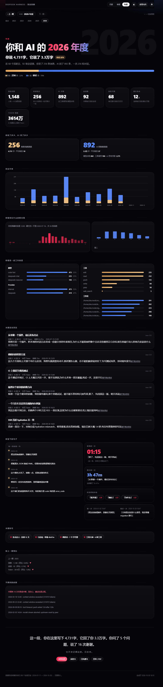

# dsh-unwrapped · 你和 AI 的年度报告

一个 DeepSeek Harness 插件，把本机**所有**历史会话自动汇成一份网易云年度报告风格的
「对话回顾」：月度 / 季度 / 年度，人类与 AI 各说了多少、什么时候说的、用了什么模型和
工具、哪几场对话最高光、你当时到底说了什么。

装一句，打开一个页面，你的这一年就在那儿了：

```bash
npx dsh-unwrapped install
```

> **不是回滚工具**。DSH 生态里 `rewind` / `recall` 那一类插件做的是「把对话和文件退回上一步」，
> 这个插件只读不写：把日志变成一份可分享的报告，不改会话、不碰工作区文件。

预览（**全部是合成演示数据**，3 年 / 260 多场虚构会话 —— 真实日志里的任何一句话都不会进仓库，
`node scripts/make-demo.mjs` 可逐字节复现）：



演示语料不是占位符拼出来的：它有跨三年的真实工作节奏、一次近 4 小时的深夜马拉松、
一段 12 天连击、几百次多步工具调用、若干子代理会话，也有失败和中断——
所以称号、高光对话、句子层里每张卡都有东西可指，而不是「示例文本」。

自包含 HTML，**双击就能用**（图表生长、数字滚动、主题切换、分享卡片、周期切换都可用，
最近 13 期已烘焙进文件，不需要 harness；超出这个窗口的周期会提示用 CLI 重跑）：
[`docs/preview-year.html`](docs/preview-year.html) ·
[`docs/preview-quarter.html`](docs/preview-quarter.html) ·
[`docs/preview-empty.html`](docs/preview-empty.html)

- **零导入**：不采集、不导出、不上传。数据源就是 harness 自己已经在写的会话日志，
  插件通过 `ctx.sessionQuery` 读取（或离线时直接读 `$DSH_HOME/sessions`）。
- **零构建**：纯 ESM 服务端插件 + 一段 inline vanilla JS，不需要客户端 bundle、不需要打包工具、没有第三方依赖。
- **零存储**：不建库、不写新文件，报告在内存里按周期现算，60 秒 TTL 缓存。
- **零 token**：只挂 HTTP 路由和一行首页链接，不进模型上下文、不产生任何推理开销。

## 它长什么样

打开 `http://127.0.0.1:8080/unwrapped`（或点击 GUI 右下角的「年度回顾」悬浮按钮）：

1. **Hero**：巨大的年份幽灵字（`2026`）压在消息占比条后面，紧跟一句反差：
   **「你说 4,731 字，它说了 3.3 万字」** + 「你说 22%」胶囊标签 —— 这一幕就是给别人截图看的。
   （这些数字来自演示语料，你的报告里会是你自己的。）
2. **KPI**：消息总数、对话轮次、AI 步数、会话数、活跃天数、最长连击、Token。
3. **你说 vs AI 说**：条数、字数、平均每条字数、思考字数、工具调用数。
4. **对话节奏**：按天（月）/ 7 天（季）/ 月（年）堆叠柱状图，人类与 AI 分色。
5. **你什么时候出现**：24 小时热度条 + 星期分布。
6. **你最常一起工作的是**：模型、Provider、工具、工作区分布。
7. **本期高光对话**：Top 6 会话，带标题、轮次、Token、持续时长，以及你当时说的原话。
8. **你留下的句子**：你在这段里说的第一句和最近一句、最晚的那一条（几点、原话）、最长的一次
   连续对话（多久、哪一场）、你重复最多的词（「能不能」×26），以及每段的第一句组成的时间线。
9. **本期称号**：夜猫子 / 早鸟 / 马拉松 / 连击达人 / 工具大师 / Token 大户 …
10. **和上一期相比**：消息、会话、Token 的环比。
11. **不顺利的时刻**：本期失败/中断次数与样例（可选）。
12. **收尾**：一句话把数字还原成记忆 ——
    「这一段，你在这里写下 4,731 字，它回了你 3.3 万字。你问了 5 个问题。」
    「它不会记得这些。日志会。」

### 交互（不是截图，是能点的页面）

页面是自包含 HTML（inline CSS + 服务端生成的 inline SVG + 一段 vanilla JS），
没有框架、没有构建、没有外部请求，但该动的地方都动了：

| 交互 | 行为 |
| --- | --- |
| 点周期标签 / 上一期 / 下一期 / 底部「最近」快捷条 | 只重新请求报告正文（`?partial=1`）并原地替换，**不整页刷新**，URL 同步更新，浏览器前进后退可用；离线打开时从文件内烘焙的 `<template>` 里切换，同样不刷新 |
| `←` / `→` | 键盘翻上一期 / 下一期 |
| 数字 | 进入视口时滚动到目标值（700ms，缓动），`prefers-reduced-motion` 下来就直接显示 |
| 柱状图 | 滚动到视口时逐根生长；鼠标悬停显示「日期 · 你 N · AI N」 |
| 卡片 | 滚动渐入（错峰 45–60ms），悬停轻微抬升 |
| 高光对话卡片 | 「展开更多原话」就地展开，不跳页 |
| `◐` | 深色 / 浅色主题切换，写入 `localStorage` |
| `分享卡片` | 浏览器内用 canvas 画一张 1080×1350 PNG（大号年份水印、四个主数字、占比条、称号、收尾句）并下载 |
| `反差卡` | 另一种模板：整张卡就是「你只占了 X%」+ 你说 / 它说的字数对照 —— 最适合发社交平台 |
| `口头禅卡` | 第三种模板：大字「你重复最多的那个词」+ 次数 |
| `⎙` / 打印 | 专有打印样式：隐藏导航与按钮、强制展开所有渐入元素、卡片不分页断裂 |

没有 JS 也能用：所有切换都是真实 `<a href>`，服务端渲染的 HTML 照样可读、可打印；
JS 只是把它们升级成无刷新体验（页面在 `<html>` 上自己加 `.js` 类，CSS 才启用渐入动画）。

### 情绪价值从哪来

统计数据不会让人想分享，具体的一句话会。所以除了 KPI 和图表，报告里专门有一层「句子层」，
全部来自你自己的日志，不做任何生成式加工：

| 位置 | 内容 | 为什么它有情绪 |
| --- | --- | --- |
| 你留下的句子 · 时间线 | 每段（天/周/月）的**第一句话** | 「每一段是怎么开始的」比「一共多少条」更像回忆 |
| 最晚的一次 / 最晚收工 | 具体时刻 + 你当时说的原话 | 一个凌晨的时间点本身就有故事；没有深夜数据时退化为「最晚收工」，不编造 |
| 最长的一次 | 连续时长 + 那场对话的标题 | 「3h 47m，那场叫《从零做一个插件…》」 |
| 你说得最多的 | 高频词 × 次数（精选词表，不是垃圾 n-gram） | 「你说「能不能」26 次」——被自己的口头禅逗笑 |
| 第一次 / 最近一次 | 首尾各一句原话 + 时间 | 起止之间就是这一段 |
| 收尾 | 字数/提问/道谢 + 一句签名 | 把前面的数字折成一句话，才是可引用的部分 |

措辞上刻意克制：第二人称、不抒情过度、不假装 AI 有感情（签名说的是「它不会记得这些。日志会。」
—— 记忆在日志里，这是事实，也是情绪落点）。分享卡片会把称号、口头禅和收尾那句一起画进 PNG。


## 同类插件里它站哪

2026-10-30 在 npm registry 按 `rewind / wrapped / 年度报告 / 回顾 / usage stats` 搜了一遍
（`node scripts/market-check.mjs` 可复跑）。DSH 生态里已经有 90+ 个和会话、用量相关的包，分三堆：

| 那一堆 | 代表 | 它们做什么 | 本插件的不同 |
| --- | --- | --- | --- |
| 回滚 / 撤回 | `dsh-rewind-plugin`、`dsh-checkpoint-rewind`、`@anionex/dsh-turn-rewind`、`dsh-recall-plugin` | 把会话和工作区文件退回某一步 | 只读不改，产出是**报告**而不是状态回退 |
| 用量 / 账单 | `@deepseek-ai/dsh-session-stats`（官方）、`@ychris12138/dsh-usage-stats`、`dsh-cost-meter`、`@kenz1117/dsh-ui-usage-billing` | token、成本、额度、侧栏看板 | 关心**谁在说话**（人类 vs AI）和「说了什么」，不只看花了多少 |
| 会话整理 | `dsh-session-flow`、`@zzerx/dsh-plugin-daily-log` | 会话级回顾归档；按模板给 agent 生成日报/周报 | 周期维度（月 / 季 / 年）+ 网易云式叙事 + 可分享单文件 HTML |

结论：**没找到同款**（月度/季度/年度 + 人类 vs AI + 句子层 + 可分享报告），
但「用量统计」「会话回顾」两个相邻位都有人了，所以定位必须说清：这不是又一个 token 看板，
也不是回滚工具。

顺带记一笔命名的坑：`rewind` 这个词在 DSH 生态里已被回滚类插件占满 —— `dsh-plugin-rewind`
（v0.0.0，占名）和 `dsh-rewind`（v0.11.12，git 还原）都不可用；`wrapped` 方向也满了 ——
`dsh-wrapped`、`dsh-recap`、`dsh-retro`、`dsh-plugin-recap` 全被占（好几个描述直接写着
"name reserved"）。最后落在 **`dsh-unwrapped`**（这个才是空的），路由是 `/unwrapped`。

## 为什么是「插件」，而不是一个新的统计服务

| 方案 | 结论 |
| --- | --- |
| 客户端 UI 插件（React + 插槽） | 需要 prebuilt CJS-factory bundle 和 `dsh-client-ui-slots` 构建链，本机未安装，且要跟着 GUI 版本升级 |
| 独立采集器 + 自己的数据库 | 违背「不引入额外中间件」；还要处理增量、去重、迁移 |
| **宿主 Cordis 插件 + 复用 web server** | 同源、同生命周期、零构建、零新存储；`dsh` 升级时按插件接口自动跟随 |

所以本插件只做三件事：

1. `ctx.sessionQuery.listSessions()` / `readSession(id)` —— 自动收集全部会话（含存档、
   含子代理会话），无需用户导入；
2. 纯函数聚合（`lib/aggregate.js`）—— 可单测、与 I/O 解耦；
3. `ctx.webServer.register({ kind: 'exact', path })` —— 把 `/unwrapped` 和 `/api/unwrapped`
   挂在**已有**的 8080 端口上，并用 `webServer.tapIndex()` 往 GUI 首页注入一行悬浮链接。

## 别人怎么用

三种方式，从「一行命令」到「手工拷贝」。**都不需要 pnpm**，也都不需要构建。

### 方式 A：一行命令（推荐）

```bash
npx dsh-unwrapped install                 # 装进 $DSH_HOME/profiles/web
npx dsh-unwrapped install --profile tui   # 换 profile
npx dsh-unwrapped install --language en --label "Wrapped"
npx dsh-unwrapped status                  # 装没装、patch 有没有、热加载开着没
npx dsh-unwrapped uninstall               # 摘掉 patch 行 + 删掉插件目录
npx dsh-unwrapped-report --period year --embed 13 --out unwrapped.html   # 不开 harness 也出报告
```

也可以全局装：`npm i -g dsh-unwrapped && dsh-unwrapped install`。
三个 bin：`dsh-unwrapped`（npx 认包名）、`dsh-unwrapped`（安装器）、
`dsh-unwrapped-report`（离线生成 HTML）。

> 还没发布到 npm 时：`git clone` 本目录后 `node bin/plugin.js install`；或 `npm pack` 出
> tarball 再 `npm i -g ./dsh-unwrapped-0.2.0.tgz`。发布步骤见
> [`docs/PUBLISH.md`](docs/PUBLISH.md)。

它做的事就两件：

1. 把 `index.js` / `lib` / `bin` / `package.json` / `README.md` 复制到
   `$DSH_HOME/profiles/<profile>/plugins/dsh-unwrapped`；
2. 在 `$DSH_HOME/profiles/<profile>/cordis.patch.yml` 里维护**唯一一行** `insert`
   （`id: rewind`，`name: ./plugins/dsh-unwrapped/index.js`）。

重跑是幂等的：已有行原地替换，顺手删掉残留的空 `[]` 文档标记（空数组后面跟块级条目
不是合法 YAML），别人的 patch 行一个字节都不动。`--dry-run` 只打印不落盘，
`patch` 子命令只把要写的那段 YAML 打到 stdout。

`$DSH_HOME` 默认 `~/.dsh`，也可以用 `--home` 指定。profile 不存在时先启动一次
`dsh --profile <name>` 让它生成，再装。

### 方式 B：`dsh plugin add`（需要 pnpm 在 PATH）

```bash
dsh plugin --profile web add dsh-unwrapped
```

然后把这段追加到 `$DSH_HOME/profiles/web/cordis.patch.yml`：

```yaml
- insert:
    - id: rewind
      name: dsh-unwrapped
      config:
        language: zh
        launcherLabel: 年度回顾
```

（`name` 用包名，走 profile 的 `node_modules`；方式 A 用相对路径，不依赖包管理器。
方式 B 不会给你 `dsh-unwrapped` 这个全局命令，升级/状态查询用 `npx dsh-unwrapped status`
或全局装一次。）

### 方式 C：手工

1. 把整个 `dsh-unwrapped/` 目录拷到 `$DSH_HOME/profiles/web/plugins/dsh-unwrapped`；
2. 在 `cordis.patch.yml` 里加：

```yaml
- insert:
    - id: rewind
      name: ./plugins/dsh-unwrapped/index.js
      config:
        language: zh
```

3. 刷新 GUI，右下角出现「年度回顾」；或直接访问 `/unwrapped`。

Web profile 默认 `patchReload: live`：改 `config`（`language` / `launcherLabel` / 路由 …）
会立即生效，**但改了插件代码（`index.js`、`lib/`）必须重启一次 `dsh web`** ——
Node 的 ESM 模块缓存按 URL 命中，patch 重新应用只是重新挂载配置，不会重新读取文件。
这就是「装完看不到新界面」最常见的原因：进程里跑的还是它启动时加载的那份代码。

> **本机已安装**：`$DSH_HOME/profiles/web/plugins/dsh-unwrapped`，patch 行 id 为
> `rewind`，已用 `dsh-rewind status` 验证。
> **注意**：当前 8080 端口那个 `dsh web` 进程启动于 v0.1，仍在提供旧版静态报告
> （旧版 `/unwrapped` 约 25 KB、无 `<script>`）。重启一次 `dsh web` 才会换成交互版。

验证安装：

```bash
node bin/plugin.js status
```

> **鉴权实况**（实测）：`/unwrapped`、`/api/unwrapped` 是由插件直接注册在本地 web server 上的
> `exact` 路由，**不走** GUI 那层浏览器 cookie 校验 —— 不带 cookie 也返回 200；
> `/` 这类 shell 路由仍然需要 cookie（首次 `/?token=…` 换到）。
> 换句话说，报告的可访问性只取决于端口可达性（默认只监听回环）。
> 想更保守：把 `path` / `apiPath` 改成不公开的路径，或关掉 `launcher`、只用离线 CLI 出文件。

如果只想看报告、连 harness 都不想开：`node bin/unwrapped.js --out unwrapped.html`（见下文）。


## 已验证

- **单测 105 个全绿**：`node --test --test-isolation=none "test/*.test.js"`，
  覆盖周期边界/时区、多帧 zstd 归档、事件抽取、聚合规则、句子层（首尾句/最晚时刻/口头禅/
  时间线/提问计数）、HTML 转义、路由与首页注入、片段渲染、内嵌周期模板、patch 文件增删。
- **真实浏览器交互**（`node scripts/browser-check.mjs`，headless Edge + DevTools 协议）：
  - 直连 harness（带 session cookie）：全部断言通过，含「点下一期 → 正文原地替换」
    （`2026 年度 → 2026 年 10 月`，URL 变 `/unwrapped?period=month&tz=480`，页面未重载）；
  - 直接打开 `docs/preview-year.html`（`file://`，无服务器）：17 项全过，含
    「2026 年度 → 2025 年度，hash `#2025`」，证明离线文件内嵌周期切换可用。
- **真机端到端（真实 harness，非 mock）**：另起一份 `dsh --profile web --no-open --port 8101`
  验证：`GET /unwrapped?period=year` → `200`（有真实数据时数字与日志一致，无 `NaN` / `undefined`）；
  `?partial=1` → `200` 只返回 `.wrap` 片段；
  `GET /api/unwrapped?period=year` → `200`；`GET /` → 已注入 `dsh-unwrapped-launcher`（`href="/unwrapped"`）。
- **旧进程诊断**：用 cookie 直连用户正在跑的 8080，`/rewind` 返回 25,073 字节、无 `<script>`、
  无 `data-count` —— 即进程里还是启动时加载的 v0.1 代码（ESM 模块缓存），重启才会换新；
  同名路由也因此从 `/rewind` 改成 `/unwrapped`（`dsh-rewind` 那个回滚插件同样要占 `/rewind`）。
  这条经验已写进上面的「更新插件」说明。
- **安装链路（含 npm 产物）**：`node bin/plugin.js install` 把插件拷进 profile 并维护 patch 行；
  改写后的 `cordis.patch.yml` 用 loader 同款 `yaml.JSON_SCHEMA` 解析通过，中文 `launcherLabel` 正常。
  另外把 `npm pack` 出的 tarball 装进临时 prefix、用它自带的 `dsh-unwrapped` 命令
  往一个**全新 `$DSH_HOME`**（只有空 profile）安装，再用该 home 真实启动 harness：
  `/unwrapped` → `200` 且是交互版，`/` 仍是 `401`（未带 cookie），空数据时显示「本期还没有数据」
  —— 即「发布后别人照命令装」这条路已跑通，只差 npm 上有没有这个包。

## 配置

`cordis.patch.yml` 里的 `config` 全部可选：

| key | 默认 | 说明 |
| --- | --- | --- |
| `path` | `/unwrapped` | 报告页路由（精确匹配） |
| `apiPath` | `/api/unwrapped` | JSON API 路由 |
| `language` | `zh` | `zh` / `en` 文案包 |
| `launcher` | `true` | 是否往 GUI 首页注入悬浮链接 |
| `launcherLabel` | `年度回顾` | 悬浮链接文案 |
| `maxSessions` | `800` | 最多读取多少个会话（按创建时间取最新） |
| `concurrency` | `4` | 并发读取会话数 |
| `cacheTtlMs` | `60000` | facts 缓存时长；过期后下一次请求重算 |
| `logErrors` | `true` | 单个会话读取失败时打日志（不影响整份报告） |

## HTTP API

```
GET /unwrapped?period=month|quarter|year&key=2026-06|2026-Q2|2026&tz=480
```

- `key` 省略 = 当前周期；非法 `key` 自动回退到当前周期。
- `tz` 是**东为正**的分钟偏移（`480` = UTC+8），缺省取宿主本地时区。周期边界按本地
  零点切分，所以同一天不会跨期。
- `/api/unwrapped` 返回 `{ period, generatedAt, report }`，字段见 `lib/aggregate.js`。
- `/unwrapped?partial=1`（或请求头 `x-rewind-partial: 1`）只返回报告正文（`.wrap` 片段，
  无 `<html>`），供页面内切换周期时原地替换；不带该参数时永远返回完整可打印页面。

页面切换周期在浏览器里走 `partial` 片段 + `history.pushState`；JS 没跑起来、被打印、
或直接用 `file://` 打开时，同样的链接会退化成普通整页导航 / 提示重跑 CLI。

## 指标口径

DSH 里一次人类提问往往会产生多条 assistant 消息：先说话、再调工具、再说。因此：

| 指标 | 口径 |
| --- | --- |
| 人类消息 | `user/message` 且 `source.kind === 'user'`（排除注入的 `AGENTS.md` / 系统上下文） |
| AI 发言 | `assistant/message` 中带可见文字的条数 |
| AI 步数 | 全部 `assistant/message`（含只发工具调用的步），即模型实际跑了几步 |
| 对话轮次 | `turn/end` 的条数（一轮问答） |
| Token | AI 侧真实上报的 usage 之和（含 cache read/write），子代理会话同样计入 |
| 工具调用 | `tool/call` 条数，按工具名聚合 |
| 马拉松 | 连续活动时长（相邻事件间隔 < 30 分钟才算一次"坐得住"） |
| 连击 | 连续有对话的日历天数 |

子代理会话（`origin: 'subagent'` / `delegationDepth > 0`）会被计入总量，并在高光对话
卡片上打「子代理」标签。

## 离线 CLI

不需要运行 harness，直接对着日志目录出报告（`docs/` 下的预览就是走这条路径生成的）：

```powershell
node bin/unwrapped.js --archive "$env:USERPROFILE\.dsh\sessions" `
  --period year --lang zh --out unwrapped.html --json report.json

node bin/unwrapped.js --period month --key 2026-10 --stdout | Out-File report.html
```

`--archive` 默认就是 `$DSH_HOME/sessions`（或 `~/.dsh/sessions`），一般不用显式传。

`--period`、`--key`、`--tz`、`--lang`、`--max-sessions`、`--out`、`--json`、`--stdout`、
`--embed <n>`、`--no-write`；`--help` 看完整说明。退出码：`0` 成功，`1` 归档缺失/不可读，`2` 参数错误。

`--embed <n>` 把最近 N 期一起烘焙进同一个 HTML（作为惰性 `<template>`），于是导出的文件
双击打开也能切周期、能前进后退，完全不需要 harness：

```bash
node bin/unwrapped.js --period year --embed 13 --out unwrapped.html
```

体积参考：13 期全量内嵌约 145 KB（CSS/JS 只写一份）。

## 开发与测试

```bash
node --test --test-isolation=none "test/*.test.js"        # 105 个用例，零依赖
node scripts/browser-check.mjs --file docs/preview-year.html   # 真浏览器交互 17 项
node scripts/market-check.mjs                                  # 查包名是否被占 + 同类插件
```

> 在受限沙箱里跑 `node --test test/` 会因为子进程管道被拦截而 `EPERM`；
> `--test-isolation=none` 让所有用例在同一个进程内执行。

| 文件 | 职责 |
| --- | --- |
| `index.js` | Cordis 插件入口：`name` / `inject` / `apply`，配置校验 |
| `lib/periods.js` | 周期解析、时区偏移、series 分桶（纯函数） |
| `lib/extract.js` | 会话事件 → 事实点（纯函数） |
| `lib/aggregate.js` | 事实点 → 周期报告（纯函数） |
| `lib/archive.js` | 离线读取多帧 zstd + JSONL 会话日志 |
| `lib/sources.js` | `sessionQuery` / 归档两种数据源 + TTL 缓存 |
| `lib/service.js` | 缓存 + 报告服务 |
| `lib/labels.js` | 中英文案包 |
| `lib/report.js` | 自包含 HTML（inline CSS + SVG 图表 + 交互脚本） |
| `lib/http.js` | 路由注册、首页注入、`partial` 片段 |
| `lib/profilePatch.js` | `cordis.patch.yml` 增删（纯函数，零 YAML 依赖） |
| `bin/unwrapped.js` | 离线 CLI |
| `bin/plugin.js` | 跨平台安装器（`install` / `uninstall` / `status` / `patch`） |
| `scripts/browser-check.mjs` | headless 浏览器交互冒烟测试（开发用） |
| `scripts/shot.mjs` | 真·整页截图：滚动触发渐入后 `captureBeyondViewport`（开发用） |
| `scripts/market-check.mjs` | 查包名是否被占 + 搜同类插件（开发用，走 registry 搜索 API） |
| `scripts/mint-cookie.mjs` | 给已运行的 harness 签一个本地 session cookie，便于直连验证（开发用） |

### 为什么需要自己拆 zstd 帧

会话日志是**多个 zstd 帧首尾相接**写进同一个 `session.v3.jsonl.zstd` 的（每次 flush
一帧）。`zstdDecompressSync` 只解第一帧，流式解压会在第二帧报
`Unknown frame descriptor`。`lib/archive.js` 按 RFC 8878 逐帧走完 header / block
链，一帧一次解码；写入被中断时尾部残帧会被丢弃，前面已提交的内容照常可读。

## 隐私

报告只在**本机**生成，HTTP 路由不鉴权但只监听已有的本地 GUI server；不会把会话内容
发送到任何远端。JSON API 会返回标题、工作区路径和最多 3 条人类提问预览（每条 170 字），
如果不想暴露，把 `language` 之外的 `path/apiPath` 改成未公开路径，或直接不装
`launcher`。

## 已知限制

- 报告里的「工作区」使用会话 header 的 `cwd`，Windows 路径会原样展示。
- `maxSessions` 之外的旧会话不参与统计（默认 800，一般够用；调大可覆盖全部历史）。
- 时区以宿主为准；跨时区漫游的用户只能选一个偏移。
- 页面不做推送式实时刷新：切换周期会重新算一次当前周期（facts 有 60s TTL 缓存），
  开着页面时新产生的对话要等下一次切换或刷新才出现。
- 分享卡片在浏览器里现画，字体用系统字体；极端环境（无 canvas、无下载权限）会退化成 toast 提示。
- 离线 HTML 用 `file://` 打开时无法请求 `partial` 片段，切周期会提示改用 CLI 重跑
  （这是刻意的：报告要保持单文件、不联网）。

## Roadmap

- 客户端 UI 插件（真正的页面内 tab）——等 `dsh-client-ui-slots` 构建链可用。
- 季度/年度对比视图（并排两期），以及「这一年 vs 上一年」的双时间轴。
- 可选按 workspace 过滤。
- 分享卡片增加二维码/链接回跳（需要 route 可分享，取决于鉴权策略）。
