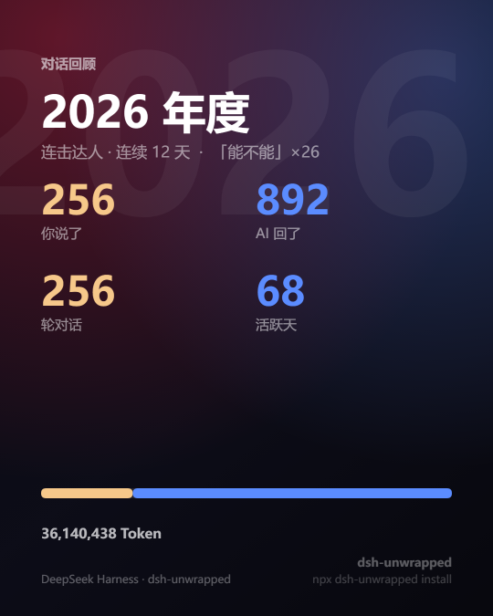
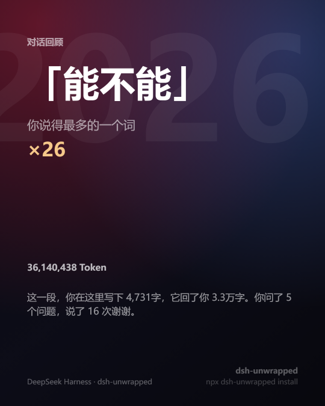

# dsh-unwrapped

[](#license)
[](package.json)
[](https://github.com/ErnestW2019/dsh-unwrapped/tree/main/test)
[](package.json)
[](https://github.com/ErnestW2019/dsh-unwrapped)

**给你的 AI 对话做一份网易云年度报告。** 月度 / 季度 / 年度，人类 vs AI 各说了多少、
什么时候说的、哪几场最高光，以及你当时到底说了什么。

```bash
npx dsh-unwrapped install
```

装完打开 `http://127.0.0.1:8080/unwrapped`，你的这一年就在那儿了。


零上传 · 零存储 · 零 token · 零构建。数据源就是 harness 已经在写的会话日志，
不调模型、不进上下文、不产生任何推理开销。

> **不是回滚工具。** `rewind` / `recall` 那一类插件做的是「把会话和文件退回上一步」，
> 这个插件只读不写：把日志变成一份可分享的报告，不改会话、不碰工作区文件。

## 你会看到什么

除了报告页，还有三种可以直接发出去的分享卡：

| 主卡 | 反差卡 | 口头禅卡 |
| :--: | :--: | :--: |
|  |  |  |
| 四个主数字 + 称号 + 收尾句 | 大字占比 + 你说 / 它说的字数对照，最适合发社交平台 | 你重复最多的那个词 |

报告页本身是**单文件 HTML**：图表生长、数字滚动、主题切换、周期切换、分享卡都在里面，
没有框架、没有构建、没有外部请求。导出的文件双击就能翻周期，不用 harness 在跑。

想直接看渲染结果：上面这张就是年度报告的首屏。完整的可交互版本（图表生长、切周期、
主题切换、分享卡）在仓库 `docs/` 下的 `preview-year.html` / `preview-quarter.html` /
`preview-empty.html`，下载后双击即可，完全离线。

## 它回答什么问题

- **谁在说话** —— 你发了多少条、AI 回了多少条、各占几成。按消息数算，不是按 token。
- **你什么时候在** —— 24 小时热度条 + 星期分布 + 最忙的一天。
- **你和谁一起干活** —— 模型、Provider、工具、工作区、Agent 预设。
- **哪几场最值得记** —— Top 6 会话：标题、轮次、Token、时长，以及你当时的原话。
- **你留下了什么句子** —— 第一次、最近一次、最晚的一条（几点、原话）、最长的一次连续对话、
  说得最多的词，以及每段的第一句话组成的时间线。

句子层全部是抽取和计数，不做任何生成式加工 —— 所以它能被反复算出同一个结果。

## 安装

需要 Node ≥ 22.15（用到 `zlib.zstdDecompressSync`）。

```bash
npx dsh-unwrapped install                 # 装进 $DSH_HOME/profiles/web
npx dsh-unwrapped install --profile tui   # 换 profile
npx dsh-unwrapped install --language en --label "Wrapped"
npx dsh-unwrapped status                  # 装没装、patch 有没有
npx dsh-unwrapped uninstall               # 摘掉 patch 行 + 删掉插件目录
```

也可以全局装：`npm i -g dsh-unwrapped && dsh-unwrapped install`。

安装器只做两件事：把插件文件复制进 `$DSH_HOME/profiles/<profile>/plugins/dsh-unwrapped`，
并在 `cordis.patch.yml` 里维护**唯一一行** `insert`。重跑是幂等的，别人的 patch 行一个字节都不动。
`--dry-run` 只打印不落盘。

> **装完看不到新界面？** 改 `config`（语言、按钮文案、路由）是热加载的，但**改了插件代码
> 必须重启一次 `dsh web`** —— Node 的 ESM 模块缓存按 URL 命中，patch 重新应用只是重新挂载配置，
> 不会重新读取文件。

不用 `npx` 的装法（`dsh plugin add` / 手工拷目录 + patch）和发布流程，见
[`docs/PUBLISH.md`](https://github.com/ErnestW2019/dsh-unwrapped/blob/main/docs/PUBLISH.md)；
不需要 harness 的离线 CLI 见下面的「离线 CLI」。

## 隐私

- 报告只在**本机**生成。不采集、不导出、不上传，没有任何远端请求。
- 插件不建库、不写新文件，读完日志在内存里按周期现算，60 秒 TTL 缓存。
- 路由注册在已有的本地 GUI server 上，默认只监听回环。
- JSON API 会返回会话标题、工作区路径和最多 3 条人类提问预览（每条 170 字）。
  不想暴露就把 `path` / `apiPath` 换成未公开路径，或者关掉 `launcher` 只用离线 CLI。

需要更保守时：

```yaml
- insert:
    - id: rewind
      name: ./plugins/dsh-unwrapped/index.js
      config:
        launcher: false
        path: /x-<随机串>
        apiPath: /x-<随机串>-api
```

## 配置

`cordis.patch.yml` 里的 `config` 全部可选：

| key | 默认 | 说明 |
| --- | --- | --- |
| `path` | `/unwrapped` | 报告页路由（精确匹配） |
| `apiPath` | `/api/unwrapped` | JSON API 路由 |
| `language` | `zh` | `zh` / `en` 文案包 |
| `launcher` | `true` | 是否往 GUI 首页注入悬浮链接 |
| `launcherLabel` | `年度回顾` | 悬浮链接文案 |
| `maxSessions` | `800` | 最多读取多少个会话（按创建时间取最新） |
| `concurrency` | `4` | 并发读取会话数 |
| `cacheTtlMs` | `60000` | facts 缓存时长；过期后下一次请求重算 |
| `logErrors` | `true` | 单个会话读取失败时打日志（不影响整份报告） |

## HTTP API

```
GET /unwrapped?period=month|quarter|year&key=2026-06|2026-Q2|2026&tz=480
GET /api/unwrapped?period=year
```

- `key` 省略 = 当前周期；非法 `key` 自动回退到当前周期。
- `tz` 是**东为正**的分钟偏移（`480` = UTC+8），缺省取宿主本地时区。周期边界按本地零点切分。
- `/api/unwrapped` 返回 `{ period, generatedAt, report }`。
- `?partial=1`（或请求头 `x-unwrapped-partial: 1`）只返回报告正文片段，供页面内切周期时原地替换。

## 离线 CLI

不需要 harness，直接对着日志目录出报告（`docs/` 下的预览就是这样生成的）：

```bash
# 默认读 $DSH_HOME/sessions（或 ~/.dsh/sessions）
node bin/unwrapped.js --period year --out unwrapped.html --json report.json

# 把最近 13 期一起烘进同一个文件，双击就能翻，完全离线
node bin/unwrapped.js --period year --embed 13 --out unwrapped.html
```

`--period` / `--key` / `--tz` / `--lang` / `--max-sessions` / `--out` / `--json` / `--stdout` /
`--embed <n>` / `--no-write`，`--help` 看完整说明。退出码：`0` 成功，`1` 归档缺失，`2` 参数错误。

## 指标口径

一次人类提问往往会产生多条 assistant 消息（先说话、再调工具、再说），所以：

| 指标 | 口径 |
| --- | --- |
| 人类消息 | `user/message` 且 `source.kind === 'user'`（排除注入的 AGENTS.md / 系统上下文） |
| AI 发言 | `assistant/message` 中带可见文字的条数 |
| AI 步数 | 全部 `assistant/message`（含只发工具调用的步） |
| 对话轮次 | `turn/end` 的条数 |
| Token | AI 侧真实上报的 usage 之和（含 cache read/write），子代理会话同样计入 |
| 马拉松 | 连续活动时长（相邻事件间隔 < 30 分钟才算一次「坐得住」） |
| 连击 | 连续有对话的日历天数 |

子代理会话（`origin: 'subagent'` / `delegationDepth > 0`）计入总量，并在高光对话卡上打标签。

## 开发与测试

```bash
node --test --test-isolation=none "test/*.test.js"              # 105 个用例，零依赖
node scripts/browser-check.mjs --file docs/preview-year.html    # 真浏览器交互 17 项
node scripts/make-demo.mjs                                      # 重建 docs/ 下的演示数据与预览
node scripts/shot.mjs --file docs/preview-year.html --out docs/preview-year.png
node scripts/shot-cards.mjs                                     # 重截三张分享卡
```

预览全部由**合成数据**生成（3 年 / 260 多场虚构会话），真实日志里的任何一句话都不会进仓库。
`make-demo.mjs` 用固定种子的 PRNG，重跑得到逐字节相同的输入。

> 受限沙箱里 `node --test test/` 会因管道被拦截而 `EPERM`；
> `--test-isolation=none` 让所有用例在同一个进程内执行。

<details>
<summary>设计取舍（点开）</summary>

### 为什么是宿主插件，而不是独立统计服务

| 方案 | 结论 |
| --- | --- |
| 客户端 UI 插件（React + 插槽） | 需要 prebuilt CJS-factory bundle 和 `dsh-client-ui-slots` 构建链，且要跟着 GUI 版本升级 |
| 独立采集器 + 自己的数据库 | 违背「不引入额外中间件」；还要处理增量、去重、迁移 |
| **宿主 Cordis 插件 + 复用 web server** | 同源、同生命周期、零构建、零新存储；`dsh` 升级时按插件接口自动跟随 |

### 它和相邻插件的关系

2026-10-30 在 npm registry 按 `rewind / wrapped / 年度报告 / 回顾 / usage stats` 搜过一遍
（`node scripts/market-check.mjs` 可复跑），DSH 生态里已有 90+ 个会话/用量相关包，分三堆：

| 那一堆 | 代表 | 它们做什么 | 本插件的不同 |
| --- | --- | --- | --- |
| 回滚 / 撤回 | `dsh-rewind-plugin`、`dsh-checkpoint-rewind`、`dsh-recall-plugin` | 把会话和工作区文件退回某一步 | 只读不改，产出是**报告** |
| 用量 / 账单 | `@deepseek-ai/dsh-session-stats`（官方）、`dsh-cost-meter` | token、成本、额度、侧栏看板 | 关心**谁在说话**和「说了什么」 |
| 会话整理 | `dsh-session-flow`、`dsh-plugin-daily-log` | 会话级归档；给 agent 生成日报/周报 | 周期维度 + 网易云式叙事 + 可分享单文件 |

没有找到同款（月度/季度/年度 + 人类 vs AI + 句子层 + 可分享报告），但两个相邻位都有人了，
所以定位必须说清：这不是又一个 token 看板，也不是回滚工具。

`rewind` 和 `wrapped` 两个词在 DSH 生态里都已被占满（好几个包描述直接写着 "name reserved"），
最后落在 `dsh-unwrapped`。

### 为什么自己拆 zstd 帧

会话日志是**多个 zstd 帧首尾相接**写进同一个 `session.v3.jsonl.zstd` 的（每次 flush 一帧）。
`zstdDecompressSync` 只解第一帧，流式解压会在第二帧报 `Unknown frame descriptor`。
`lib/archive.js` 按 RFC 8878 逐帧走完 header / block 链，一帧一次解码；
写入被中断时尾部残帧会被丢弃，前面已提交的内容照常可读。

### 代码结构

| 文件 | 职责 |
| --- | --- |
| `index.js` | Cordis 插件入口：`name` / `inject` / `apply`，配置校验 |
| `lib/periods.js` | 周期解析、时区偏移、series 分桶（纯函数） |
| `lib/extract.js` | 会话事件 → 事实点（纯函数） |
| `lib/aggregate.js` | 事实点 → 周期报告（纯函数） |
| `lib/archive.js` | 离线读取多帧 zstd + JSONL 会话日志 |
| `lib/sources.js` | `sessionQuery` / 归档两种数据源 + TTL 缓存 |
| `lib/service.js` | 缓存 + 报告服务 |
| `lib/labels.js` | 中英文案包 |
| `lib/report.js` | 自包含 HTML（inline CSS + SVG 图表 + 交互脚本） |
| `lib/http.js` | 路由注册、首页注入、`partial` 片段 |
| `lib/profilePatch.js` | `cordis.patch.yml` 增删（纯函数，零 YAML 依赖） |
| `bin/unwrapped.js` | 离线 CLI |
| `bin/plugin.js` | 跨平台安装器（`install` / `uninstall` / `status` / `patch`） |

</details>

## 已知限制

- 「工作区」直接用会话 header 的 `cwd`，Windows 路径原样展示。
- `maxSessions` 之外的旧会话不参与统计（默认 800；调大可覆盖全部历史）。
- 时区以宿主为准，跨时区漫游只能选一个偏移。
- 不做推送式刷新：开着页面时的新对话要等下一次切换或刷新才出现。
- 分享卡在浏览器里现画，字体用系统字体；无 canvas / 无下载权限时退化成 toast 提示。
- `file://` 打开的离线 HTML 切周期只覆盖烘焙进去的那几期，超出会提示用 CLI 重跑。

## License

[MIT](https://github.com/ErnestW2019/dsh-unwrapped/blob/main/LICENSE)

---

[English](https://github.com/ErnestW2019/dsh-unwrapped/blob/main/README.en.md)
